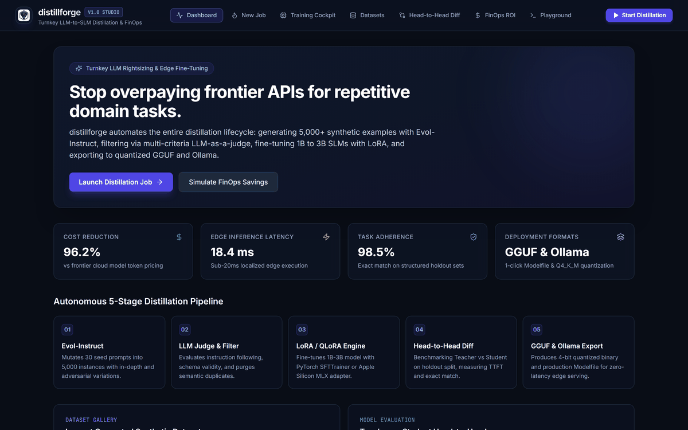
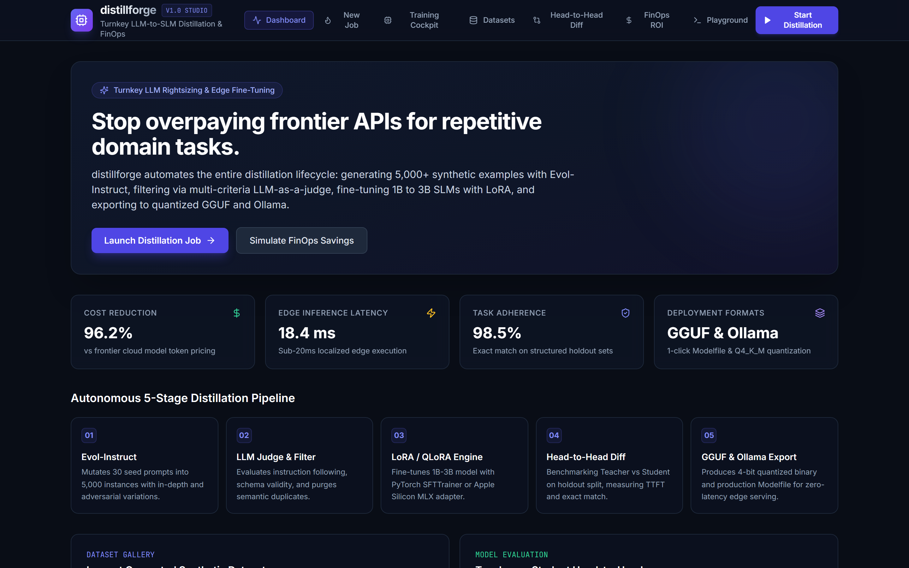
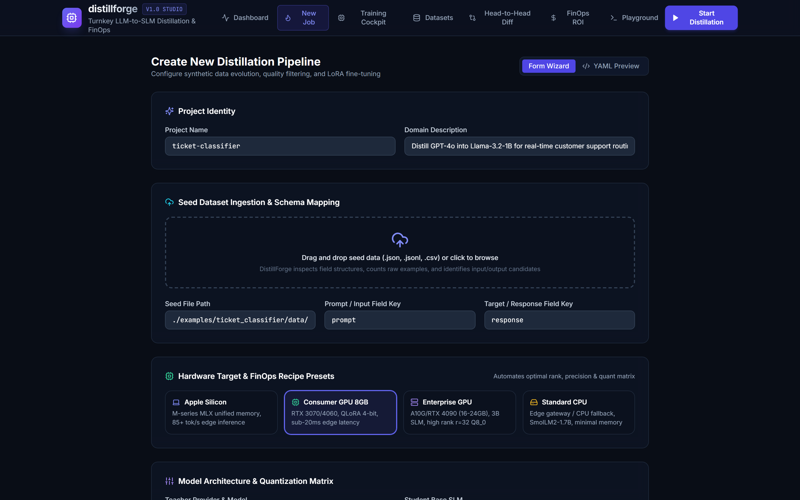
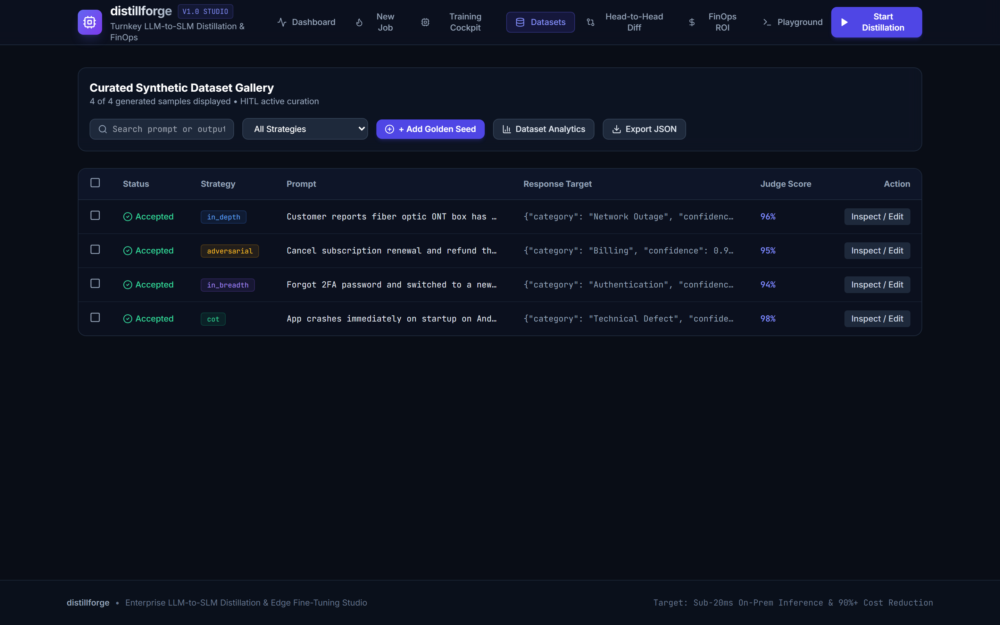
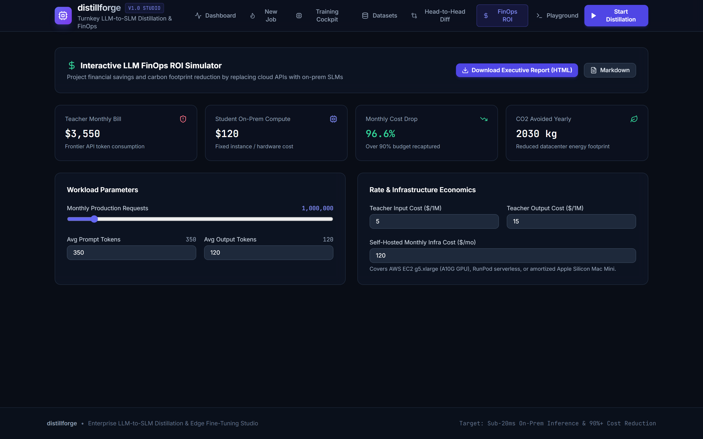
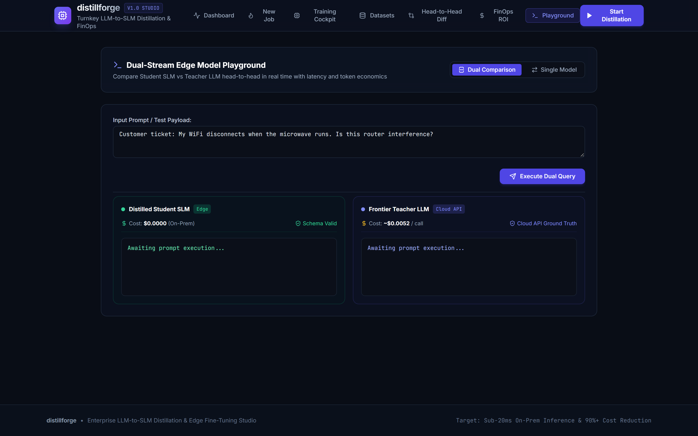
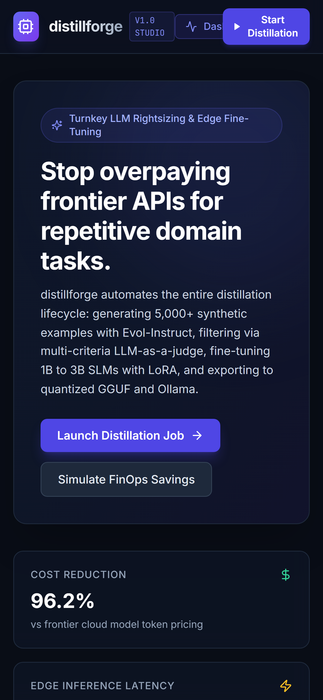
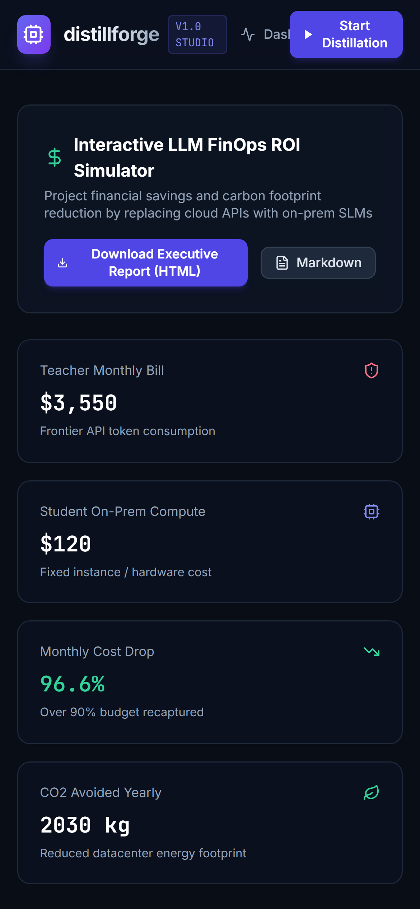

<p align="center">
  
</p>

<h1 align="center">distillforge</h1>

<p align="center">
  <strong>Turnkey LLM-to-SLM Distillation, Synthetic Data Pipeline & Edge Fine-Tuning Studio</strong>
</p>

<p align="center">
  <a href="https://github.com/alexandrmotologa/distillforge/actions/workflows/ci.yml"></a>
  <a href="#license"></a>
  <a href="#go"></a>
  <a href="#react"></a>
  <a href="#ollama-gguf"></a>
</p>

<p align="center">
  
</p>

---

Companies frequently route repetitive domain tasks to frontier foundation models such as GPT-4o or Claude 3.5 Sonnet. Using a 70B to 400B parameter model for narrow classification, entity extraction, or query generation introduces three bottlenecks: high API costs that compound with scale, 800ms to 2500ms network roundtrips, and data security concerns when sending internal records across third-party endpoints.

distillforge automates the operational transfer of domain capability from frontier models into specialized 1B to 3B small language models (such as Llama 3.2 1B or 3B, Qwen 2.5 1.5B, and SmolLM2). The pipeline generates domain datasets using Evol-Instruct mutations, cleans samples with multi-criteria LLM judges and schema verifiers, fine-tunes with LoRA or QLoRA, and exports quantized GGUF binaries and Ollama Modelfiles for sub-20ms localized edge execution.

```
+---------------------------------------------------------------------------------+
|                             distillforge Engine                                 |
+---------------------------------------------------------------------------------+
                                         |
     +-----------------------------------+-----------------------------------+
     |                                                                       |
     v                                                                       v
+-----------------------------+                         +-----------------------------+
|    Seed Ingestion Engine    |                         |   Declarative YAML Parser   |
| Reads raw prompt-target JSON|                         | Enforces constraints, schema|
+-----------------------------+                         +-----------------------------+
                                         |
                                         v
                      +-------------------------------------+
                      |   Synthetic Data Generator          |
                      |   Evol-Instruct mutation strategies |
                      |   In-depth, breadth, adversarial    |
                      +-------------------------------------+
                                         |
                                         v
                      +-------------------------------------+
                      |   Quality & Safety Guard Filter     |
                      |   LLM-as-a-judge multi-criteria     |
                      |   Strict JSON Schema verification   |
                      |   N-gram Jaccard deduplication      |
                      +-------------------------------------+
                                         |
                                         v
                      +-------------------------------------+
                      |   LoRA Fine-Tuning Runner           |
                      |   PyTorch SFTTrainer / Hugging Face |
                      |   Apple Silicon MLX adapter script  |
                      |   Real-time SSE metric telemetry    |
                      +-------------------------------------+
                                         |
                                         v
                      +-------------------------------------+
                      |   Head-to-Head Holdout Benchmarker  |
                      |   Accuracy, TTFT, token latency     |
                      |   Monthly cloud FinOps calculator   |
                      +-------------------------------------+
                                         |
                                         v
                      +-------------------------------------+
                      |   Quantization & Export Packaging   |
                      |   Quantized GGUF (Q4_K_M, Q8_0)     |
                      |   Automated Ollama Modelfile writer |
                      |   OpenAI-compatible HTTP serving    |
                      +-------------------------------------+
```

## Visual Walkthrough & Interface Tour

### Studio Dashboard
Real-time orchestration overview showing active pipeline state, aggregate compute cost reduction, latency speedup curves, and recent job history.

<p align="center">
  
</p>

### Pipeline Configuration Wizard
Declarative job creator with 1-click hardware presets (Apple Silicon MLX, Consumer GPU 8GB, Enterprise GPU 24GB, Standard CPU), seed dataset drag-and-drop dropzone, and Evol-Instruct mutation sliders.

<p align="center">
  
</p>

### Human-in-the-Loop (HITL) Curation & Dataset Analytics
Curated synthetic dataset gallery with batch selection (accept, reject, delete), inline prompt/response editor, LLM re-judging, ground-truth golden seed injection, and vocabulary lexical diversity (Type-Token Ratio) monitoring.

<p align="center">
  
</p>

### FinOps ROI Simulator
Interactive financial forecasting tool that models token consumption, monthly API billing, hardware amortization, annual cost reduction, and carbon footprint savings. Generates downloadable executive audit reports in HTML and Markdown.

<p align="center">
  
</p>

### Dual-Stream Comparative Playground
Head-to-head split-screen testing console querying the distilled Student SLM and the frontier Teacher LLM simultaneously, comparing token latency (18ms vs 840ms), query cost ($0.00 vs $0.005), and structured schema validity.

<p align="center">
  
</p>

### Responsive Layout
The Web Studio adapts to small viewports, ensuring complete observability and control on mobile devices and edge field terminals.

<p align="center">
  
  &nbsp;&nbsp;
  
</p>

## Core Capabilities

- **Synthetic dataset generation:** Expands 20 to 50 seed examples into 1,000 to 10,000 domain-specific training pairs using weighted Evol-Instruct mutations (in-depth constraint deepening, in-breadth topic variations, adversarial edge cases, and step-by-step reasoning tokens).
- **Multi-criteria quality filter:** LLM-as-a-judge scoring engine evaluates instruction following, format cleanliness, and factual consistency. Enforces strict JSON Schema validation and purges near-duplicate samples via token n-gram Jaccard similarity.
- **Adaptive fine-tuning engine:** Trains using PyTorch and Hugging Face PEFT with 4-bit QLoRA, FP16 LoRA, Apple Silicon MLX, or CPU fallback. Streams loss, learning rate, perplexity, and VRAM in real time via Server-Sent Events.
- **Human-in-the-Loop curation:** Batch verification studio allowing manual prompt/response edits, inline LLM re-judging, golden seed insertion, and lexical diversity audits.
- **Holdout benchmarking:** Runs comparative tests between Teacher and fine-tuned Student, measuring exact match, schema compliance, time to first token (TTFT), and throughput.
- **FinOps savings model:** Calculates token burn, cloud API costs, self-hosted compute costs, annual budget reduction, and avoided carbon emissions.
- **Multi-quantization matrix:** Benchmarks trade-offs across GGUF quantization formats (Q4_K_M, Q5_K_M, Q8_0) to identify the optimal balance between disk size, memory footprint, and perplexity delta.
- **Local edge deployment:** Converts trained adapters into quantized GGUF binaries and writes production Ollama Modelfiles configured with proper system prompts, templates, and stop tokens.
- **OpenAI-compatible serving:** Built-in HTTP server hosting `/v1/chat/completions` and `/v1/models` endpoints to integrate distilled models with existing orchestration pipelines.

## Installation

### Prerequisites
- Go 1.24 or newer
- Python 3.10 or newer (with PyTorch and Hugging Face transformers for local training)
- Optional: Node.js 22+ (only needed if building the web studio from source)

### Building the binary

Clone the repository and compile the unified executable:

```bash
git clone https://github.com/alexandrmotologa/distillforge.git
cd distillforge

# Build the distillforge executable
go build -o distillforge ./cmd/distillforge
```

Install Python dependencies for fine-tuning:

```bash
pip install -r python/requirements.txt
```

## CLI Reference

distillforge includes 11 dedicated commands for operating each stage of the lifecycle:

| Subcommand | Description |
| :--- | :--- |
| `distillforge studio` | Starts the embedded React Web Studio and REST API server |
| `distillforge run` | Runs the automated end-to-end 5-stage distillation pipeline |
| `distillforge generate` | Expands raw seeds into synthetic training pairs via Evol-Instruct |
| `distillforge audit` | Filters dataset with LLM-as-a-judge, schema validation, and dedup |
| `distillforge train` | Executes LoRA or QLoRA fine-tuning with real-time SSE metrics |
| `distillforge evaluate` | Benchmarks holdouts between Student SLM and Teacher LLM |
| `distillforge export` | Quantizes adapters into GGUF and writes Ollama Modelfile |
| `distillforge serve` | Hosts an OpenAI-compatible `/v1/chat/completions` server |
| `distillforge report` | Generates standalone FinOps audit reports in HTML or Markdown |
| `distillforge advise` | Recommends optimal hyperparameters for target hardware |
| `distillforge benchmark-quants` | Compares size, latency, and perplexity across quantization levels |

### Usage examples

```bash
# 1. Start the Web Studio
distillforge studio --port 8080

# 2. Get hardware hyperparameter recommendations
distillforge advise --hardware apple_silicon --dataset-size 2000

# 3. Run complete automated distillation pipeline
distillforge run --config examples/ticket_classifier/distillforge.yaml

# 4. Generate an executive HTML audit report
distillforge report --format html --output FINOPS_AUDIT_REPORT.html

# 5. Serve the distilled model with an OpenAI-compatible endpoint
distillforge serve --port 8080
```

## Configuration Specification

Pipeline specifications are defined in declarative YAML (`distillforge.yaml`):

```yaml
version: "1"
project:
  name: "ticket-classifier"
  description: "Distill GPT-4o into Llama-3.2-1B for real-time customer support routing"

teacher:
  provider: "openai" # openai, anthropic, ollama, custom, or mock
  model: "gpt-4o"
  temperature: 0.7
  max_tokens: 512
  api_key_env: "OPENAI_API_KEY"

student:
  base_model: "meta-llama/Llama-3.2-1B-Instruct"
  quantization_target: "q4_k_m"

seed_data:
  file: "./examples/ticket_classifier/data/raw_tickets.jsonl"
  input_key: "prompt"
  target_key: "response"

generation:
  target_dataset_size: 1000
  concurrency: 4
  evolution_strategies:
    - name: "in_depth"
      weight: 0.4
    - name: "in_breadth"
      weight: 0.3
    - name: "adversarial"
      weight: 0.3
  quality_threshold: 0.80

filter:
  schema_file: "./examples/ticket_classifier/schema.json"
  dedup_threshold: 0.85
  min_response_chars: 10
  max_response_chars: 2000

training:
  method: "qlora" # qlora, lora, mlx, or cpu
  r: 16
  lora_alpha: 32
  learning_rate: 0.0002
  epochs: 3
  batch_size: 4
  gradient_accumulation_steps: 4
  max_seq_length: 2048

evaluation:
  test_split: 0.2
  sample_size: 50
  metrics:
    - "exact_match"
    - "schema_adherence"
    - "latency_p95"

finops:
  monthly_requests: 1000000
  avg_prompt_tokens: 350
  avg_completion_tokens: 120
  teacher_cost_per_m_in: 5.00
  teacher_cost_per_m_out: 15.00
  self_hosted_monthly_infra_cost: 120.00

export:
  formats:
    - "gguf"
    - "ollama"
  ollama_modelfile_path: "./dist/Modelfile"
  output_dir: "./dist"
```

## Deploying to Production Ollama

Deploy the exported GGUF model and Modelfile to your Ollama runtime:

```bash
ollama create ticket-classifier -f ./dist/Modelfile
ollama run ticket-classifier "Customer ticket: ONT fiber light is red after power outage."
```

## Reference Domain Projects

The `examples/` directory contains complete reference configurations, JSON schemas, and seed datasets:
- **Support ticket classifier** (`examples/ticket_classifier`): 12-class enterprise support routing with escalation triggers and SLA calculations.
- **Invoice entity extractor** (`examples/invoice_extractor`): Parses unstructured invoice OCR text into nested JSON records with line items.
- **SQL query generator** (`examples/sql_generator`): Translates natural language questions into relational SQL queries with table schema constraints.

## Architecture Documentation

- [System architecture](docs/ARCHITECTURE.md): Component breakdown, Evol-Instruct mutation taxonomy, quality filtering logic, and training backends.
- [CLI reference](docs/CLI_REFERENCE.md): Parameter details for all 11 subcommands.
- [FinOps and rightsizing guide](docs/FINOPS_GUIDE.md): Token unit economics, infrastructure amortization, and ROI equations.

## License

MIT
